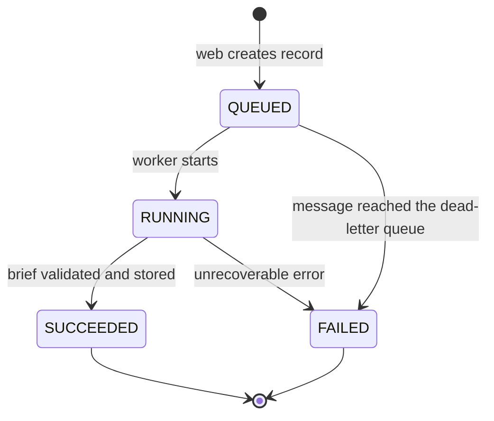

# Job contract, v1

| Field | Value |
| --- | --- |
| Status | Proposed |
| Owners | Erika (web, worker), Daniel (infra) |
| Related | [design.md](../design.md), issue #1 |

This contract defines everything that crosses a boundary between the web service, the worker, and the infrastructure. Changes are additive only: adding an optional field is allowed; renaming, removing, or changing a field's meaning requires `v2`. Readers must ignore fields they don't recognize.

## Conventions

- Field names are `snake_case`.
- Timestamps are ISO 8601 strings in UTC with a `Z` suffix, e.g. `2026-10-21T13:00:00Z`.
- `job_id` is a ULID (26 characters, sorts by creation time), generated by the web service.
- `schema_version` is the integer `1` for everything in this document.

## Environment variables (provided by infra)

| Variable | Used by | Meaning |
| --- | --- | --- |
| `JOBS_QUEUE_URL` | web | SQS queue URL to send jobs to |
| `JOBS_TABLE_NAME` | web, worker | DynamoDB table name |
| `BRIEFS_BUCKET_NAME` | web, worker | S3 bucket for briefs and evidence |
| `OPENROUTER_API_KEY` | worker | OpenRouter API key (Lambda environment variable; secret) |
| `TWITTER_BEARER_TOKEN` | worker | X API v2 bearer token (Lambda environment variable; secret) |
| `AWS_REGION` | web, worker | Region of all resources |

No other configuration crosses the boundary. Local development sets the same names in an untracked `.env.local` file at the repo root; the worker never reads it inside Lambda. When a table, bucket, or queue variable is unset, the worker falls back to `settings.yaml` (`dynamodb`, `bucket_name`, `sqs`, `region`).

## SQS message

Sent by the web service, consumed by the worker. The message carries only what the worker needs to start; everything else is read from DynamoDB.

```json
{
  "schema_version": 1,
  "job_id": "01JADQ7Y3K8V5C2N9W4R6T1M0P",
  "theme": "AI and compute",
  "requested_at": "2026-10-21T13:00:00Z"
}
```

| Field | Type | Required | Notes |
| --- | --- | --- | --- |
| `schema_version` | integer | yes | Always `1` |
| `job_id` | string | yes | Same ID as the DynamoDB record |
| `theme` | string | yes | 1 to 1000 characters, trimmed by the web service |
| `requested_at` | string | yes | When the user submitted |

## DynamoDB record (table from `JOBS_TABLE_NAME`)

Partition key: `job_id`.

| Field | Type | Written by | Notes |
| --- | --- | --- | --- |
| `job_id` | string | web | Partition key |
| `schema_version` | number | web | `1` |
| `theme` | string | web | Same as the message |
| `status` | string | web (create), then worker | See state machine below |
| `stage` | string | worker | One of the stage values below; absent while `QUEUED` |
| `created_at` | string | web | |
| `updated_at` | string | web (create), then worker | Every write updates it |
| `s3_key` | string | worker | Set only when `SUCCEEDED` |
| `error` | map | worker | Set only when `FAILED`; shape below |
| `ttl` | number | web | Unix seconds, `created_at` + 30 days |

Rule: after creating the record, the web service only reads it. Only the worker changes it.

If the worker receives a message whose record does not exist (a job enqueued without the web service, e.g. by `worker/scripts/enqueue_job.py`), it creates the record from the message in the same conditional write that moves it to `RUNNING`.

Note: `status` is a DynamoDB reserved word, so every expression that names it must use `ExpressionAttributeNames` (e.g. `#s` for `status`).

### Status state machine



Each transition is a conditional write that checks the current `status`. A transition that is not in this diagram must fail. On duplicate delivery, the worker sees a status other than `QUEUED`, skips the job, and deletes the message. The exception: if the record is still `RUNNING` and SQS reports the message was received before (`ApproximateReceiveCount` > 1), the previous attempt died mid-run (crash or Lambda timeout), so the worker moves it to `FAILED` with code `INTERNAL`.

### Stage values

In pipeline order: `universe`, `theme_mapping`, `collecting`, `sentiment`, `strategy`, `review`, `validation`.

The web service may show these to the user, mapped to friendly text it owns (e.g. `sentiment` → "Reading the market mood").

### Error shape

```json
{
  "stage": "validation",
  "code": "LIMIT_EXCEEDED",
  "message": "Allocations sum to 115%, above the 100% limit."
}
```

| Code | Meaning |
| --- | --- |
| `NO_DATA` | No data source returned usable results |
| `LLM_INVALID_OUTPUT` | Model output failed to parse after the retry |
| `LLM_UNAVAILABLE` | OpenRouter errored or timed out after retries |
| `REVIEW_REJECTED` | The risk reviewer rejected the strategy twice |
| `LIMIT_EXCEEDED` | The validator found a hard-limit violation |
| `INTERNAL` | Anything else; details go to logs, not to `message` |

`message` is shown to users, so it never contains stack traces, keys, or raw model output.

## S3 layout (bucket from `BRIEFS_BUCKET_NAME`)

| Key | Content type | Written by |
| --- | --- | --- |
| `briefs/YYYY/MM/DD/<job_id>.md` | `text/markdown` | worker |
| `briefs/YYYY/MM/DD/<job_id>.sources.json` | `application/json` | worker |

The date parts come from `created_at`. The web service always reads the key from `s3_key` and never builds it itself.

## Fixtures and contract tests

Example files live in `contracts/fixtures/`:

- `message.valid.json`, `message.missing_theme.json`
- `record.queued.json`, `record.succeeded.json`, `record.failed.json`

The Go tests and the Python tests both load these files. Valid fixtures must parse; invalid ones must be rejected. If either side's types drift from this document, CI fails.
